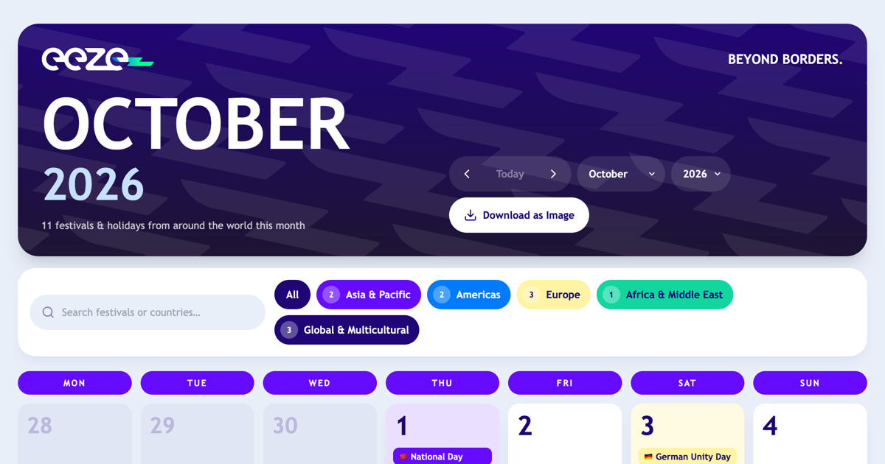

# Beyond Borders — the eeze culture calendar

Beyond Borders started as Rhoda's GlobalBeat. It is a visual, interactive calendar of world festivals, regional holidays and global traditions. You can browse month by month, filter by region, search for any festival or country, and download the current month as an image.

It's made for educators, remote teams, travellers and anyone curious about the world.



---

## Features

- **Monthly calendar.** It opens on the current month. You can step back and forward, jump back to **Today**, or pick any month and year from the dropdowns. The ← and → keys also change the month.
- **138 cultural events** in five colour-coded regions:
  - Asia & Pacific (purple)
  - Americas (blue)
  - Europe (pale yellow)
  - Africa & Middle East (green)
  - Global & Multicultural (dark blue)
- **Correct dates every year.** Fixed dates are simple. Holidays like Easter, Thanksgiving and Notting Hill Carnival are calculated for any year. Lunar festivals such as Lunar New Year, Diwali, Eid and Holi use date tables for 2024–2030.
- **Event cards.** Click any event to see its region and flag, the date, a short overview, and an **Explore Full Story ↗** button that opens Wikipedia in a new tab.
- **Busy days stay tidy.** Each day shows up to three events, plus a **+X more** link that lists the rest.
- **Search and filters.** Type a festival or country name to search the whole year. Region buttons switch each culture on or off.
- **Download as Image.** Saves the current month, including any filters, as a high-resolution PNG named like `beyond-borders-2026-10.png`.
- **Works on desktop and tablet.** Phones can view it, but event labels get cut short on small screens.

## TV mode

Add `?tv` to the address (for example `https://…/?tv`) to show the office TV version. It fills one 16:9 screen: the month grid on the left, today's events on the right (they take turns every 15 seconds), and the next few events below. It needs no mouse or keyboard. It moves on at midnight by itself and reloads at 04:00 every night to pick up changes. The settings are at the top of `src/tv/TvMode.jsx`.

## Tech stack

| Part | Tool |
| --- | --- |
| UI | [React 18](https://react.dev) |
| Build tool | [Vite 5](https://vitejs.dev) |
| Styling | [Tailwind CSS 3](https://tailwindcss.com) |
| Icons | [Lucide](https://lucide.dev) |
| Fonts | Trebuchet MS (the eeze brand's stand-in for Obviously), no web fonts |
| Hosting | [Vercel](https://vercel.com) |

There's no backend, database or API key. The whole site is static files, so hosting on Vercel's free plan is enough.

## Project structure

```
├── index.html                 ← page title, description, icon and social preview tags
├── package.json               ← project name, scripts and dependencies
├── tailwind.config.js         ← makes the brand colours available as classes (bg-eeze-purple …)
├── public/
│   ├── brand/                 ← eeze logo, bolt pattern and favicon
│   └── og-image.png           ← preview image for social media links (1200×630 screenshot)
└── src/
    ├── main.jsx               ← starts the app
    ├── index.css              ← page font, colours and shared styles
    ├── theme.js               ← eeze brand colours and font: change the look here
    ├── App.jsx                ← the page: state, filters and layout
    ├── data/
    │   ├── events.js          ← all events: add or edit them here
    │   ├── regions.js         ← the 5 regions, their names and colours
    │   └── lunarDates.js      ← typed-in dates for lunar festivals (2024–2030)
    ├── lib/
    │   ├── calendar.js        ← works out each year's dates and the month grid
    │   ├── dateRules.js       ← rules for moving holidays (Easter, "4th Thursday" …)
    │   └── exportImage.js     ← draws the "Download as Image" PNG
    ├── components/            ← header, search, region filters, grid and popups
    └── tv/TvMode.jsx          ← the office TV screen (?tv)
```

## Common changes

- **Add or edit an event:** `src/data/events.js`. The comment at the top explains each field.
- **Cover a new year for lunar festivals:** add a line to each table in `src/data/lunarDates.js`.
- **Change a colour:** `src/theme.js` (brand colours) or `src/data/regions.js` (which colour each region uses).

## Running it

```
npm install
npm run dev      # http://localhost:5173
npm run build    # static site in dist/
```
